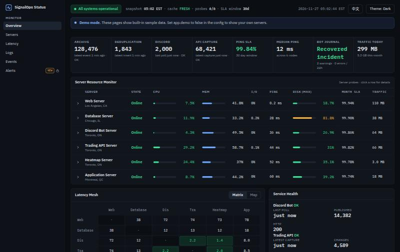
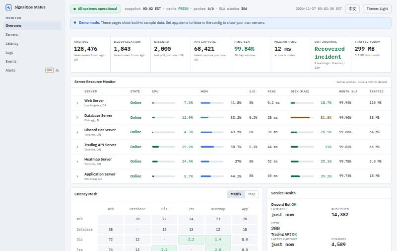
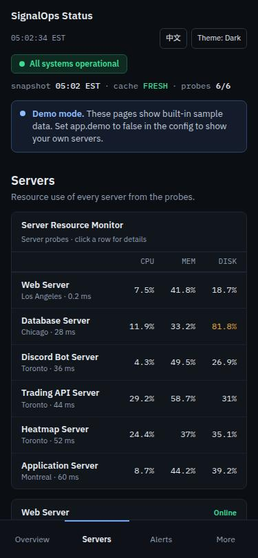

# SignalOps Status

**PHP Based status dashboard for Discord bots, trading services, and private server fleets.**

SignalOps Status is a self-hosted operations page for teams that run Discord alert bots, trading or market-data APIs, archival databases, and small private fleets. It is built with plain PHP, ships with a full demo mode, and can be dropped onto a normal PHP hosting panel without a JavaScript build step.

Search keywords: PHP Based status page, self-hosted status dashboard, Discord bot monitoring, server monitoring dashboard, uptime monitoring, NOC dashboard, trading bot status page, market data API status, Tailscale server status, Cloudflare cacheable status page.



v0.3 replaces the single page with a dense NOC console split into pages: **Overview, Servers, Latency, Logs, Events, Alerts**. It ships in English and Simplified Chinese, with dark and light themes. Theme and language follow the system by default, and the visitor's choice is remembered. The v0.2 single-page dashboard is still served at `/index.php`.

| Light theme | Phone |
| --- | --- |
|  |  |

## Highlights

- **PHP Based**: no Node build pipeline, no frontend framework, no external SaaS dependency. Plain CSS + ES-module JS, self-hosted IBM Plex fonts.
- Multi-page console (Overview, Servers, Latency, Logs, Events, Alerts) behind a tiny front controller and router.
- English and Simplified Chinese UI (`?lang=en|zh-CN`, remembered in a cookie, defaults to the browser language).
- Dark, light, and system themes (`?theme=`, remembered in a cookie; works without JavaScript).
- Phone layout with a bottom tab bar.
- Live in-place refresh of numbers on the overview without reloading the page.
- Latency as a 6x6-style matrix (default) or a zoomable map with clickable nodes.
- Alerts page that shows the JSON export of any external health checker, behind a password login.
- Discord bot health cards from private `/health.json` endpoints.
- Sanitized Discord bot error journal from systemd/journald.
- CPU, memory, I/O wait, load, uptime, disk, services, and private-network traffic.
- Ping-only SLA, separate from service health.
- Optional MySQL summary for archived trading signals or bot events.
- Demo mode is enabled by default, so the dashboard works immediately after clone.
- Stale-first cache with optional tmpfs snapshots, browser revalidation, and CDN-friendly headers.
- Private operator-page guidance for authenticated journals or diagnostics without unsafe CDN caching.
- Redacts IPs, URLs, bearer tokens, bot tokens, long IDs, and common secret patterns before rendering.

## Good Fit

SignalOps Status is designed for:

- Discord trading alert bots.
- Options flow, market scanner, and signal delivery infrastructure.
- Small private networks on Tailscale, WireGuard, or a trusted LAN.
- Operators who want a public-facing status page without exposing private hosts or credentials.

It is not intended to be a full observability stack like Grafana, Prometheus, or Datadog. It is a polished status surface: fast to install, easy to read, and safe enough to put in front of a community.

## Quick Start

Run the demo locally:

```bash
php -S 127.0.0.1:8080 -t public scripts/dev-router.php
```

The router script gives the PHP built-in server the same clean URLs (`/servers`, `/latency`, ...) that the nginx example provides.

Open:

```text
http://127.0.0.1:8080
```

Demo mode is controlled by `app.demo`. The default is `true`.

## Production Install

Copy the example config outside the web root:

```bash
sudo install -d -m 0750 -o root -g www-data /etc/signalops-status
sudo install -m 0640 -o root -g www-data config/signalops.example.php /etc/signalops-status/config.php
sudo install -d -m 0750 -o www-data -g www-data /var/lib/signalops-status
```

Edit `/etc/signalops-status/config.php`:

```php
'app' => [
    'demo' => false,
],
```

Point your virtual host document root at `public/` and send unknown paths to `public/index.php` (front controller). [deploy/nginx/signalops-status.conf](deploy/nginx/signalops-status.conf) is a complete example with long-lived caching for `/assets/site/`. If your hosting panel can only point at the repository root, `index.php` forwards to `public/index.php`, but clean URLs and the new assets need `public/` as the document root.

The new pages only read the snapshot written by the cache warmer. Until it has run once (or until someone opens the classic page at `/index.php`), they show a "no snapshot yet" notice. Install the timer from [Cache Warmer](#cache-warmer).

### Pages

| Path | Page |
| --- | --- |
| `/`, `/overview` | KPIs, server table, latency matrix, service health, bot journal, events, runtime. |
| `/servers` | Server table with expandable details (CPU model, services, disks, traffic, SLA). |
| `/latency` | Latency matrix; `?view=map` for the map. |
| `/logs` | Sanitized Discord bot error journal and service health. |
| `/events` | Latest archived signals/events from the optional database. |
| `/alerts` | Alerts from an external health checker (login required). |
| `/overview/live` | JSON used by the overview's live refresh. |
| `/index.php` | The v0.2 single-page dashboard. |

### Alerts and Login

`/alerts` is a private page. Set a password hash in config:

```bash
php -r 'echo password_hash("your-password", PASSWORD_DEFAULT), PHP_EOL;'
```

```php
'auth' => [
    'enabled' => true,
    'password_hash' => '$2y$10$...',
],
```

Login uses a PHP session plus CSRF token, and private pages are sent `no-store` so a CDN never caches them. In demo mode with no password configured, `/alerts` opens without login and shows sample alerts. With demo off and no password, it returns 503.

SignalOps does not decide what is an alert. A separate health checker (cron script, monitoring agent, systemd timer) writes a JSON file to `alerts.export_path` (default `/var/lib/signalops-status/alerts/page.json`), and the page shows it. Write the file atomically (temp file + rename) and make it readable by the web server user. Format (`signalops-healthcheck-page-v1`):

```json
{
  "schema": "signalops-healthcheck-page-v1",
  "version": 1,
  "host": "web",
  "generated_at_utc": "2026-01-01T12:00:00Z",
  "last_run_utc": "2026-01-01T12:00:00Z",
  "active": [
    {"id": "disk:db:/var/lib/mysql", "severity": "P2", "title": "Disk usage above 80%",
     "detail": "81.8% used", "since": "2026-01-01T09:00:00Z", "last_seen": "2026-01-01T12:00:00Z",
     "last_notified": null, "count": 90}
  ],
  "recent": [
    {"kind": "recovered", "id": "svc:discord-bot", "severity": "P1", "title": "discord-bot.service was not active",
     "detail": "", "since": "2026-01-01T07:10:00Z", "at": "2026-01-01T07:14:00Z"}
  ]
}
```

Severities are `P0`–`P3`. `recent` is newest first (around 7 days, at most 50 rows). Timestamps may be ISO 8601 strings or Unix seconds. If `last_run_utc` is older than `alerts.stale_after_seconds` (300), the page warns that the checker is late. Never put secrets in titles or details.

## Probe Model

SignalOps can monitor machines in three ways:

| Kind | Description |
| --- | --- |
| `local` | Reads `/proc`, disks, services, ping targets, and optional journal units on the web server. |
| `ssh` | Runs a short remote probe through SSH. Use a restricted SSH key or a forced command. |
| `endpoint` | Uses a machine payload returned by an HTTP health endpoint. |

The included probe template lives at:

```text
scripts/signalops-status-probe.py
```

Recommended authorized key style:

```text
command="/usr/local/bin/signalops-status-probe",no-agent-forwarding,no-X11-forwarding,no-port-forwarding,no-pty ssh-ed25519 AAAA...
```

Customize `DISKS`, `SERVICES`, `PING_TARGETS`, and `JOURNAL_UNITS` in the probe script for each host.

## Discord Error Journal

The Discord journal card reads warning/error entries from configured systemd units, then sanitizes each message before rendering it.

The page does not render raw logs. It redacts:

- URLs and private hosts.
- bearer tokens and Discord bot tokens.
- `password=`, `token=`, `secret=`, `key=`, and similar fields.
- long IDs and long random strings.

## Configuration

Use `config/signalops.example.php` as the production template. Keep real values outside the repository.

Important fields:

| Field | Purpose |
| --- | --- |
| `app.demo` | Set to `false` for production. |
| `app.timezone` | Time zone for the header clock and timestamps. |
| `auth.password_hash` | `password_hash()` output for the login on private pages. |
| `alerts.export_path` | Health-checker JSON shown on `/alerts`. |
| `alerts.stale_after_seconds` | Warn when the checker's last run is older than this. |
| `ui.cache_dir` | Page-data cache for the routed pages (default `/dev/shm/signalops-status/ui`). |
| `cache.path` | JSON snapshot path. Linux installs can use `/dev/shm/signalops-status/status-cache.json` for tmpfs-backed cache. |
| `cache.serve_expired_seconds` | Keep serving an older snapshot while probes recover. |
| `cache.php_cli` | PHP CLI binary used for background cache refresh workers. |
| `cache.cdn.enabled` | Emit CDN-friendly headers for Cloudflare or another edge cache. |
| `endpoints.discord.url` | Private Discord bot `/health.json`. |
| `endpoints.api.url` | Private trading API `/health.json`. |
| `machines[].journal_units` | systemd units to summarize in the error journal. |
| `machines[].latency_targets` | Private hostnames/IPs for point-to-point latency. |
| `latency_map.nodes` | Display labels, cities, optional `short` matrix labels, and fixed map coordinates. |
| `database.summary_sql` | Optional SQL for archive summary metrics. |
| `database.recent_sql` | Optional SQL for latest signals/events table. |
| `database.kinds_sql` | Optional SQL for the archive breakdown by kind. |

## Cloudflare CDN

SignalOps can sit behind Cloudflare, but Cloudflare does not cache HTML automatically. To make the public status page cacheable at the edge, enable CDN headers in private config:

```php
'cache' => [
    'cdn' => [
        'enabled' => true,
        'edge_max_age' => 60,
        'stale_while_revalidate' => 300,
        'stale_if_error' => 604800,
    ],
],
```

Then add a Cloudflare Cache Rule for only the status hostname:

- Cache eligibility: `Eligible for cache`
- Origin Cache Control: respect origin headers
- Cache key: ignore query string unless your deployment uses query parameters for different pages
- Keep authenticated or user-specific pages outside this rule

When enabled, SignalOps sends `Cache-Control`, `CDN-Cache-Control`, and `Cloudflare-CDN-Cache-Control` headers with short edge TTLs and stale-if-error protection.

See [docs/cloudflare-cache-rules.md](docs/cloudflare-cache-rules.md) for the full Cloudflare setup, including the exact Cache Rule and verification commands.

If you extend SignalOps with authenticated journals or internal diagnostics, keep those routes outside CDN caching and use an origin-side performance model instead. See [docs/private-operator-pages.md](docs/private-operator-pages.md).

## Cache Warmer

Production installs can keep the public snapshot hot with the optional systemd units in `deploy/systemd/`.

Adjust `WorkingDirectory`, `ExecStart`, `User`, and `Group` for your server, then install:

```bash
sudo install -m 0644 deploy/systemd/signalops-status-cache.service /etc/systemd/system/signalops-status-cache.service
sudo install -m 0644 deploy/systemd/signalops-status-cache.timer /etc/systemd/system/signalops-status-cache.timer
sudo systemctl daemon-reload
sudo systemctl enable --now signalops-status-cache.timer
```

The timer refreshes `scripts/refresh-cache.php` every minute. This keeps most public requests on the fast cache-read path while private probes run out of band.

## Security Notes

- Do not commit `config/signalops.php`, `/etc/signalops-status/config.php`, SSH keys, tokens, hostnames, or generated state files.
- Use a read-only database account.
- Keep health endpoints on an encrypted private network.
- Prefer forced-command SSH keys for probes.
- Treat public status pages as marketing surfaces: show health, not secrets.
- Keep `/alerts` and any other login pages out of CDN cache rules. They already send `Cache-Control: no-store, private`.

## Development

```bash
php scripts/test-core.php
php scripts/test-home.php
```

Code layout: `src/` (namespace `SignalOps\Status\`, PSR-4, no Composer), routes in `src/Routes/`, nav in `src/Nav/`, templates in `templates/`, strings in `lang/en` and `lang/zh-CN`, assets in `public/assets/site/{core,home}/`. The collectors in `app/` are shared with the classic page. See [ARCHITECTURE.md](ARCHITECTURE.md).

## Requirements

- PHP 8.1 or newer.
- Linux for resource probing.
- `ssh`, `ping`, and `systemctl` for machine probes.
- PDO MySQL only if you enable the optional database summary.

## Related Ideas

SignalOps Status works well beside:

- Discord bot repositories.
- Trading signal APIs.
- Options heatmap or scanner workers.
- Public Discord community landing pages.

## License

MIT
